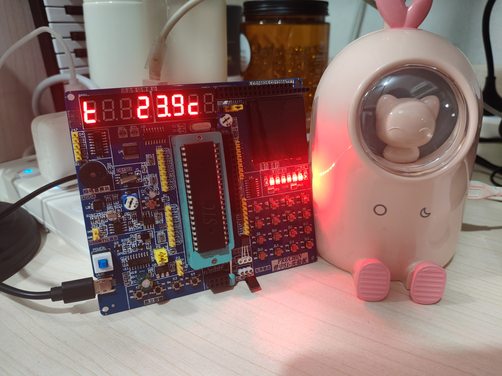
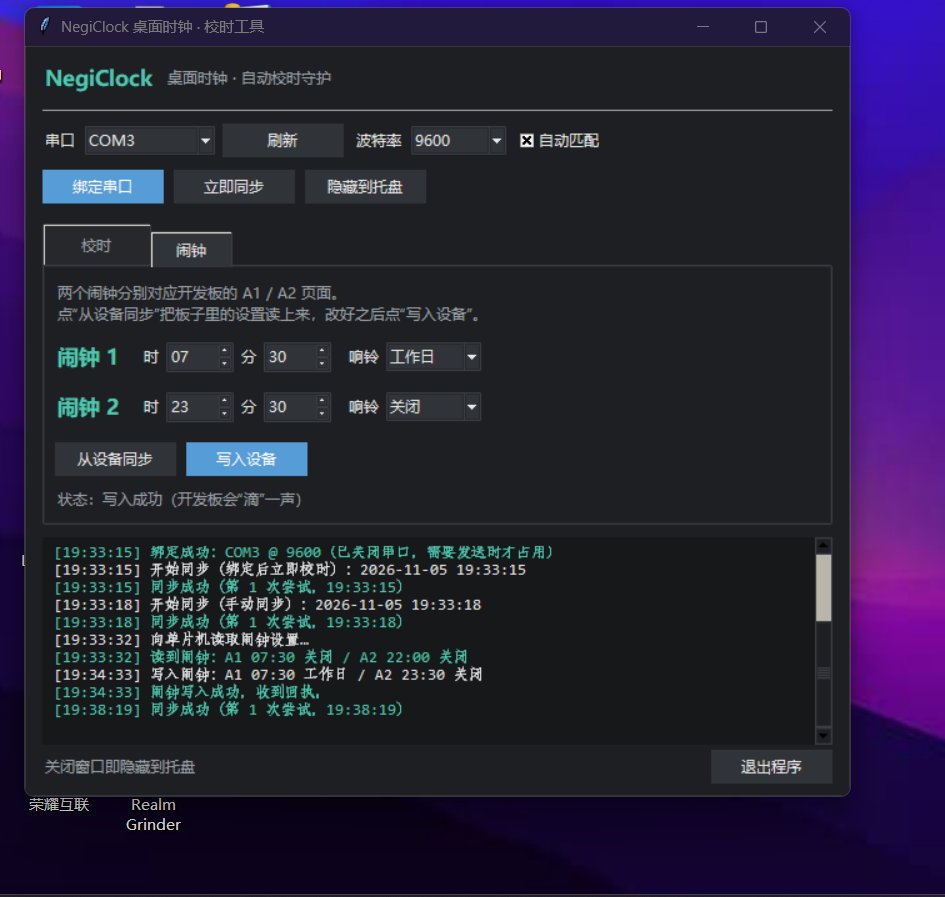

# NegiClock

把一块闲置的普中 HC6800-ES V2.0（STC89C52）开发板改造成的桌面时钟。

8 位数码管显示时间、日期和温度，DS1302 走时，DS18B20 测温，4 个独立按键操作，
带两组闹钟和整点报时；电脑上的上位机每 5 分钟自动校准一次时间，
因为板子上没有纽扣电池，断电再上电时间会归零。



## 功能

| 功能 | 说明 |
|---|---|
| 走时 | DS1302，24 小时制，星期由年月日实时算出 |
| 显示 | 25 秒一循环：15 秒时间 → 5 秒日期 → 5 秒温度 |
| 设置 | 时、分、秒、日、月、年逐项调整，按年月自动判断每月天数 |
| 测温 | DS18B20，显示格式 `t 23.1c`，负数带负号，保留一位小数 |
| 闹钟 | 两组，支持工作日 / 每天 / 一次 / 关闭；响铃计划用 8 个小数点直观显示 |
| 整点报时 | 08:00–23:00 每个整点响一声，可随时开关 |
| 亮度 | 三档，按 UP 切换 |
| 校时 | 上位机每 5 分钟自动对时，带回执与重发 |
| 上位机 | 深色界面、托盘常驻、可读写闹钟 |

## 硬件

- 开发板：普中 HC6800-ES V2.0，STC89C52RC，12MHz 晶振
- 主控工程在 `C51/`，用 Keil uVision（C51）编译；工程文件 `C51/0710.uvproj`

用到的外设与引脚：

| 外设 | 引脚 |
|---|---|
| 数码管段码 | P0.0~P0.7（经 74HC573） |
| 数码管位选 | P2.2 / P2.3 / P2.4（74LS138） |
| DS1302 | P3.6 SCLK，P3.4 I/O，P3.5 CE |
| DS18B20 | P3.7 |
| 独立按键 | P3.1 / P3.0 / P3.2 / P3.3 |
| 蜂鸣器 | P2.5（并驱 P1.5） |
| 串口 | P3.0 RXD，P3.1 TXD |

板上有几处引脚复用，代码里都做了规避，细节见 [技术说明](Docs/技术说明.md)：

- P2.2~P2.4 同时接 74LS138 和 LED D3/D4/D5，扫描时必然闪烁，软件关不掉；
- P2.1 是 DAC 输入也是 LED D2，DA 灯要灭就得让 D2 常亮；
- P2.5 是蜂鸣器也是 LED D6，蜂鸣器静音就得让 D6 常亮；
- P3.5 既是 DS1302 的 CE 又是 XPT2046 的 CS，测温期间要把 CE 拉高，否则 XPT2046 会占住 P3.7。

## 使用方法

### 页面

开发板有三个页面，平时按 **DOWN** 循环切换：

1. **时钟页**：15 秒时间 → 5 秒日期 → 5 秒温度循环显示
2. **闹钟 A1**
3. **闹钟 A2**

### 按键

板子上四个按键从左到右依次是 `-`、`设置`、`+`、`下一项`。

| 按键 | 平时（时钟页） | 平时（闹钟页） | 设置状态 |
|---|---|---|---|
| `-` | 翻到下一页 | 翻到下一页 | 数值减小（循环） |
| `设置` | 进入时间设置 | 进入该闹钟设置 | 保存并退出 |
| `+` | 切换亮度 | 切换亮度 | 数值增大（循环） |
| `下一项` | 整点报时开 / 关 | 切换响铃方式 | 切换到下一项 |

设置时当前项 0.5 秒闪烁一次；每次有效按键都会“滴”一声；按住 `+`/`-` 超过 0.6 秒开始连发。
进入时间设置后，时钟暂停刷新，保存时才写回 DS1302。

### 显示格式

```
时间   14-22-34        日期   12-23  2        温度   t  23.1c
```

- 时间页最右一位的小数点每秒闪烁一次。
- 日期页最后一位是星期，1 表示星期一。
- 温度页的 `t` 和 `c` 用 7 段数码管拼出，没有单独的 ℃ 符号可用。
- 闹钟页显示 `A1 13-22`，8 个小数点表示响铃计划：前 7 个对应周一到周日，最后一个表示“只响一次”。

| 响铃方式 | 小数点 |
|---|---|
| 关闭 | 全灭 |
| 工作日 | 前 5 个亮 |
| 每天 | 前 7 个全亮 |
| 一次 | 只有第 8 个亮 |

闹钟响铃时是“滴滴滴滴——滴滴滴滴”循环，按任意键停止，这次按键不会再触发别的功能；
“一次”模式响过之后自动变回关闭。

## 上位机



`上位机/NegiClockTool.exe` 是打包好的独立程序，双击即可运行，不需要安装 Python。

1. 选择串口（CH340），波特率保持 9600 并勾选“自动匹配”，点“绑定串口”；
2. 绑定成功后立即校时一次，之后每 5 分钟自动校时；
3. 只有发送时才打开串口，发送结束立即关闭，平时不占用；
4. 单片机收到后回 ACK，收不到就 1 秒后重发，最多 3 次；
5. 关闭窗口会隐藏到托盘，双击托盘图标可以重新打开。

“闹钟”页可以把开发板里的两组闹钟读回来、改好再写回去，写入成功时开发板会“滴”一声，
接收指示灯 D1 闪三下。

详细说明见 [上位机使用说明](上位机/使用说明.md)。

## 目录结构

```
NegiClock/
├─ C51/            Keil uVision 工程与全部单片机源码
├─ 上位机/         上位机 Python 源码、打包好的 exe、使用说明
├─ Docs/           实物照片、截图、技术说明
└─ README.md
```

## 编译与烧录

1. 用 Keil uVision 打开 `C51/0710.uvproj`，按 F7 编译，输出 `C51/Objects/0710.hex`；
2. 打开 STC-ISP，芯片选 STC89C52RC，加载刚生成的 hex，点“下载”后给板子重新上电；
3. 上电会响一次 do-mi-sol 三音提示音，说明程序已经跑起来；
4. 如果数码管全灭，检查跳线 J21 是否接在 VCC 一侧。

## 串口协议

```
PC -> MCU:  A5 5A LEN CMD DATA... XOR

0x00  心跳（用于测波特率）              MCU 回 ACK
0x01  校时  LEN=8  年 月 日 星期 时 分 秒  MCU 回 ACK
0x02  读闹钟                            MCU 回闹钟数据帧
0x03  写闹钟  LEN=7  两组 时/分/模式     MCU 回 ACK

MCU -> PC:  A5 5A 01 06 F8                       ACK
            A5 5A 07 82 h1 m1 mode1 h2 m2 mode2 XOR   闹钟数据
```

`mode`：0 关闭，1 工作日，2 每天，3 一次。

## 已知限制

- 板子上没有纽扣电池，断电后时间会丢失，上电先显示 `24-01-01 12:00:00`，等上位机校时后恢复；
- D2、D6 常亮，D3~D5 半亮，这是引脚复用导致的，只能拆掉对应 LED 或 RP7/RP9 排阻；
- 读取温度的那 0.8 秒内不访问 DS1302，秒数会短暂停顿；
- 按住 `设置` 或 `-` 时，串口收不到数据（这两个按键和 RXD/TXD 共用引脚）。

## 文档

- [上位机使用说明](上位机/使用说明.md)
- [技术说明（引脚冲突、显示、闹钟、协议、更新记录）](Docs/技术说明.md)
